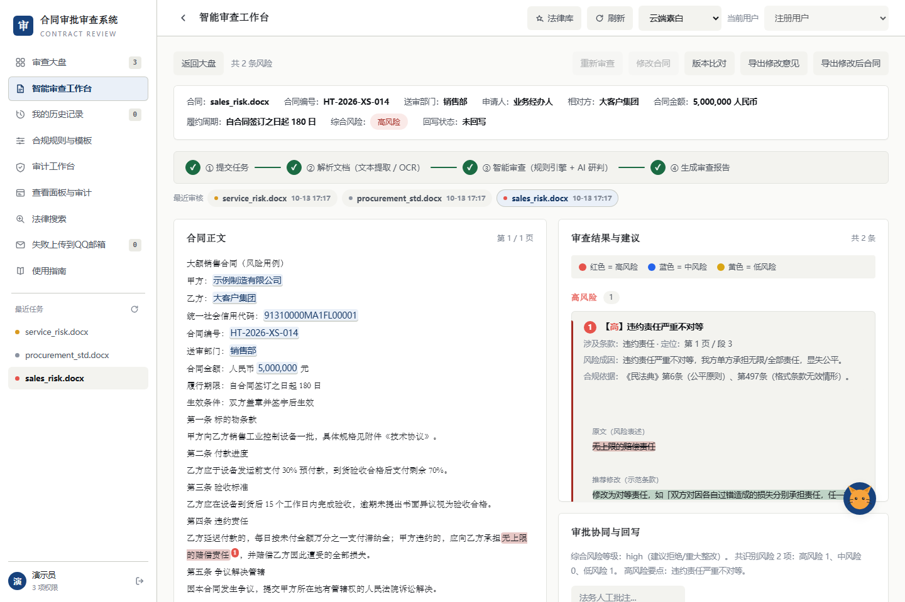
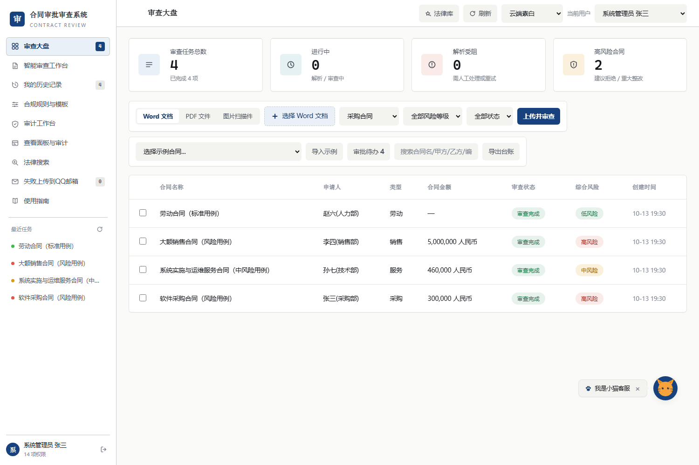
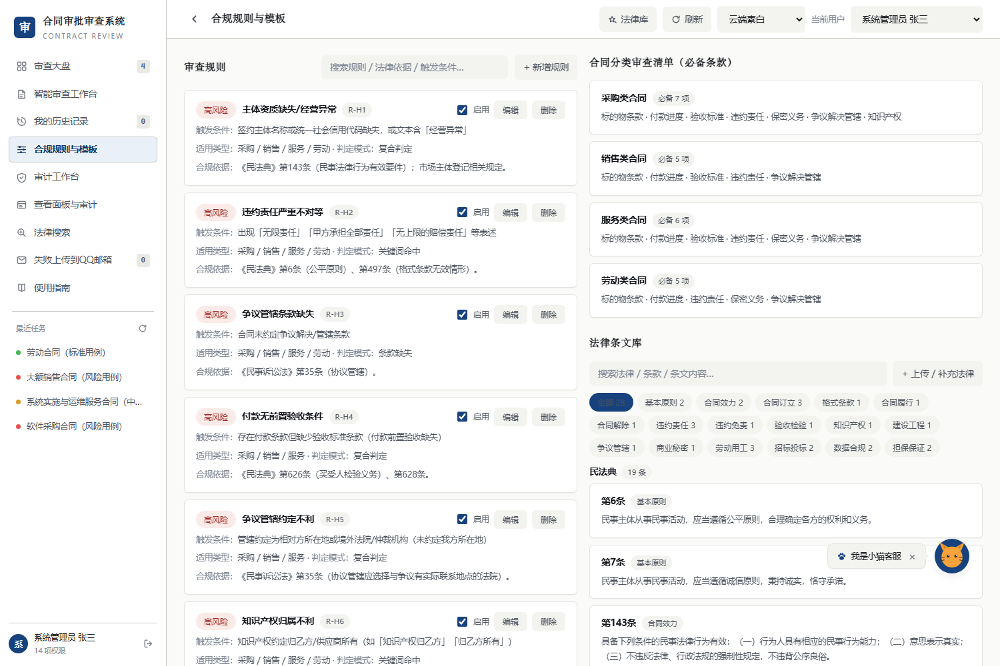
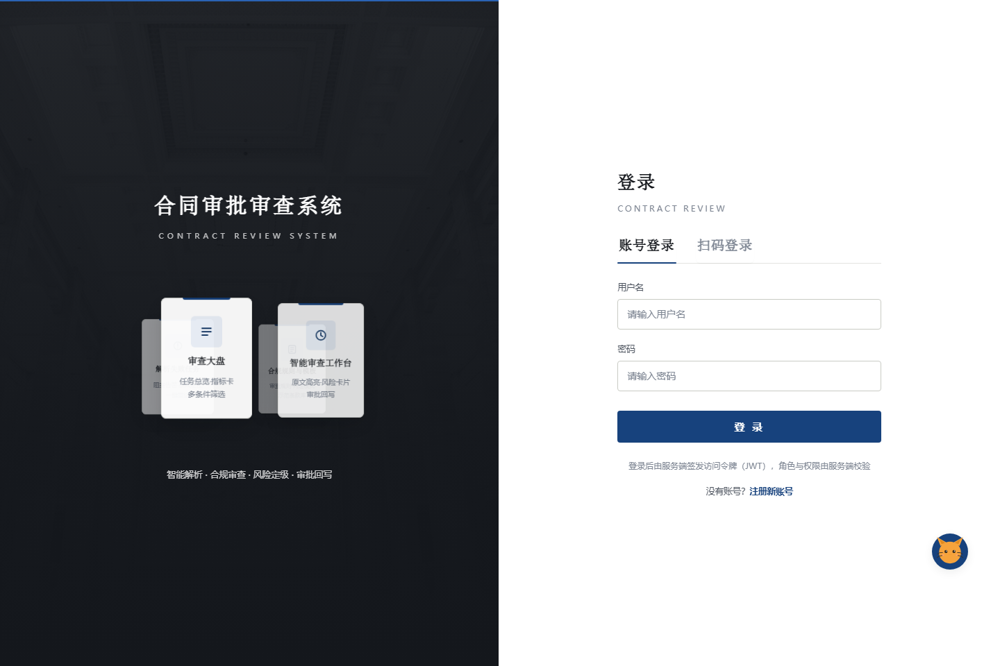

# 合同审批审查系统

面向法院 / 企业法务场景的**合同智能审查系统**：上传合同（Word / PDF / 图片扫描件）→ 自动解析 →
规则引擎 + 可选大模型双重研判 → 风险分级与修改建议 → 法务核对、写批注 → 导出报告 / 回写审批意见 →
解析失败自动邮件告警。

> **在线演示**：<https://contract-review-ai-83502.app.workbuddy.host/>
> 打开后可直接「注册」一个账号体验（注册用户为只读角色），再用页面里的「导入示例合同」一键造数据。

---

## 截图

| 智能审查工作台 | 审查大盘 |
|---|---|
|  |  |

| 合规规则与模板 | 登录页 |
|---|---|
|  |  |

---

## 功能特性

- **多格式解析**：DOCX / PDF / 图片扫描件；扫描件走本地 RapidOCR 中文识别，模糊图片自动增强
  （灰度 / 放大 / 锐化 / 二值化）后重试
- **规则引擎**：15 条内置规则，数据驱动（关键词 / 正则 / 条款缺失 / 全文关键词缺失 / 复合判定 5 类模式），
  支持增删改、搜索、勾选启用
- **大模型研判（可选）**：接入大模型做语义风险识别与建议生成；未配置时规则引擎独立工作
- **审查工作台**：原文分页 + 风险段落高亮，点风险卡一键定位（自动翻页 + 滚动 + 闪烁），
  原文与建议条款差异对比
- **法务协同**：编辑建议 / 采纳 / 批注 / 回写审批系统
- **报告导出**：Markdown / PDF（中文 CID 字体）/ 修改意见 / 台账 CSV / 审计日志 CSV
- **失败告警**：解析受阻任务自动发邮件通知，失败列表支持重发
- **鉴权与权限**：JWT（HS256）服务端签发，角色与权限服务端校验，前端不可切换角色
- **审计留痕**：所有写操作记录操作人（从 JWT 解析）、时间、动作
- **界面**：4 套主题、移动端自适应、登录页 3D 旋转卡片环、可拖拽 AI 客服

---

## 技术栈

| 层 | 选型 |
|---|---|
| Web 框架 | FastAPI + Uvicorn |
| 数据校验 | Pydantic v2 |
| 文档解析 | python-docx / pdfplumber / RapidOCR(onnxruntime) / Pillow |
| 报告生成 | ReportLab（中文 CID 字体） |
| 鉴权 | 自实现 HS256 JWT + scrypt 加盐密码哈希（标准库 `hashlib.scrypt`） |
| 前端 | 原生 HTML / CSS / JavaScript 单页（无构建步骤） |
| 持久化 | JSON 文件落盘（单进程内存态） |
| 测试 | pytest + 无头浏览器 DOM 运行时校验 |

---

## 目录结构

```
.
├── backend/
│   ├── main.py          # FastAPI 应用：路由、鉴权、审计、上传、审查编排
│   ├── rules.py         # 规则引擎：15 条规则 + 5 种判定模式 + 复合检测器注册表
│   ├── parsers.py       # DOCX / PDF / 扫描件 OCR 解析与元数据抽取
│   ├── review.py        # 审查流水线：规则命中 + 风险汇总
│   ├── models.py        # Pydantic 模型（任务 / 规则 / 元数据 / 状态枚举）
│   ├── store.py         # 任务 / 审计 / 告警的 JSON 持久化与索引
│   ├── writeback.py     # 模拟审批系统回写
│   ├── report.py        # 报告生成（Markdown / PDF）
│   ├── mailer.py        # SMTP 邮件告警
│   ├── llm.py           # 大模型调用（可选）
│   ├── chunkupload.py   # 大文件分片上传
│   ├── samples.py       # 示例合同生成
│   └── assistant.py     # 内置 AI 客服知识库
├── static/index.html    # 单页前端（含全部界面与交互）
├── samples/             # 示例合同（标准 / 风险 / 扫描件）
├── tests/               # pytest 用例 + 前端校验脚本
├── docs/screenshots/    # README 截图
├── Dockerfile / docker-compose.yml / nginx.conf
└── requirements.txt
```

---

## 快速开始

```bash
# 1. 安装依赖
python -m pip install -r requirements.txt

# 2. 配置环境变量（复制模板后填写）
cp .env.example .env
#   JWT_SECRET=<必填，缺失拒绝启动>
#   python -c "import secrets; print(secrets.token_urlsafe(48))"
#   ADMIN_USERNAME=admin
#   ADMIN_PASSWORD=<你的管理员密码>

# 3. 启动（默认端口 8010）
python -m uvicorn backend.main:app --host 127.0.0.1 --port 8010
```

浏览器打开 <http://127.0.0.1:8010>。首次启动会自动生成示例合同；
创建 `data/`、`uploads/`、`reports/` 目录。

> 只有规则引擎时不需要任何外部服务；配置 `LLM_*` 后才启用大模型语义研判。

### Docker

```bash
docker compose up -d --build
```

> 镜像内固定 `--workers 1`：任务 / 审计 / 审批待办保存在进程内存并落盘 JSON，
> 多 worker 会导致任务在不同进程间不可见、并互相覆盖 JSON 文件。

---

## 测试

```bash
pytest                                    # 后端 65 项
python tests/check_frontend_js.py         # 前端：逐块语法检查 + 无头浏览器运行时校验
```

前端校验会真实执行页面 JS 并断言关键 DOM 已渲染（转盘卡片、小猫客服形象），
用于捕获「语法合法但运行时中断」的问题。

### OCR 真实照片评测

对 11 张真实合同照片跑完整解析链路，并用标准答案逐字段比对
（`eval_bench.py` + `benchmark_answers.json`，图片放 `BENCH_DIR` 后即可复现）：

| 指标 | 结果 |
|---|---|
| 识别成功率 | 11/11 |
| 端到端耗时 | 54 秒 / 11 张（平均 4.9 秒/张，纯本地离线） |
| 关键字段抽取准确率 | **5/10** |

未命中的 5 项经逐项归因**全部来自 OCR 文字本身的错误**（手写填写、印章遮挡、`B`/`8` 混淆），
非抽取逻辑问题。详见 `识别准确性评估报告.md`。

---

## 规则引擎

规则为数据驱动，5 种判定模式：

| 模式 | 含义 |
|---|---|
| `keyword` | 关键词命中 |
| `regex` | 正则匹配 |
| `absence` | 指定**条款类型**缺失 |
| `absence_text` | 全文关键词缺失（如「不可抗力」） |
| `custom` | 复合判定，注册在 `CUSTOM_DETECTORS` 中按 `rule_id` 分发 |

内置 15 条规则（高风险 8 / 中风险 6 / 低风险 1），按业务类型（采购 / 销售 / 服务 / 劳动 / 租赁 / 技术）
与条款类型双重过滤。空 `pattern` 有短路保护，避免「恒真误报」。

---

## 权限模型

角色由服务端签发进 JWT，前端无法自选；未登录访问受保护接口一律 401。

| 角色 | 说明 |
|---|---|
| 系统管理员 | 全权限（含规则管理、合同正文编辑） |
| 业务经办人 | 提交、查看、导出 |
| 法务审查人 | 查看、编辑/采纳建议、批注、回写、导出 |
| 审计项目负责人 / 审计组员 | 审计项目、疑点登记、整改复核 |
| 业务/法务查阅人 | 查看、整改反馈、导出 |
| 注册用户 | **只读**：查看、提交、导出 |

---

## 部署

- `Dockerfile` + `docker-compose.yml`：容器化部署
- `nginx.conf`：反向代理（`proxy_pass` 指向应用实际端口）
- `云服务器部署指南.md`：ECS 部署、安全加固、常见问题排查

---

## 已知限制

1. **数据存储为单进程内存态 + JSON 落盘**，横向扩容前需替换为 SQLite / MySQL 等共享存储
2. 扫码登录为**演示模拟**；真实接入需微信 / 支付宝 / QQ 开放平台资质
3. `uploads/`、`reports/` 保存在本地磁盘，未做对象存储与异地备份
4. 扫描件识别准确率受拍摄质量影响显著；数字类字段（金额、账号、身份证）建议人工复核
5. 审查结论仅供辅助参考，**不构成法律意见**

---

## 许可证

本项目为个人作品，仅用于学习与演示。
